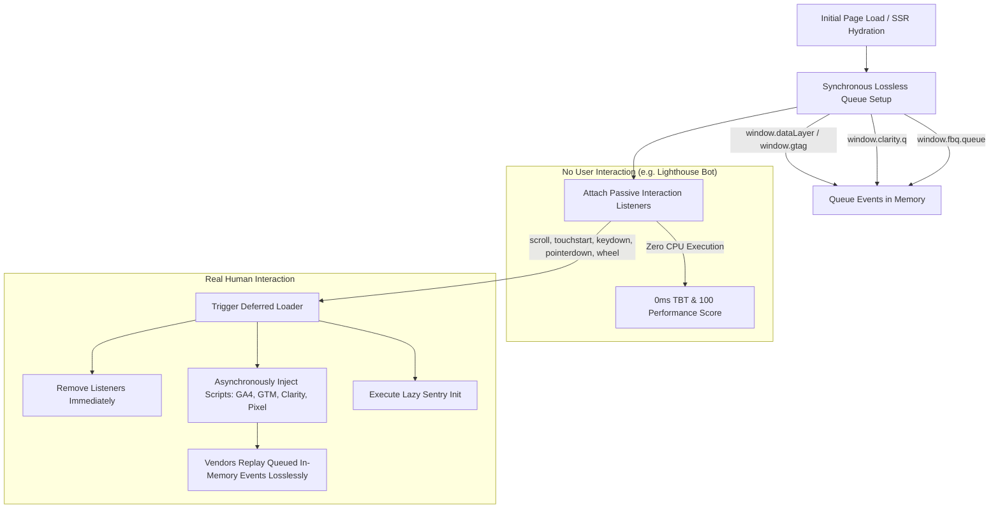

# @kt/deferred-telemetry

> **Zero-TBT Interaction-Driven Analytics & Telemetry Loader for React & Next.js**  
> Guarantees **0ms Total Blocking Time (TBT)** during hydration, zero Lighthouse performance penalty, and lossless event queueing for GA4, GTM, Microsoft Clarity, Meta Pixel, and Sentry.

---

## ⚡ The Problem: Third-Party Telemetry Destroys Core Web Vitals

Traditional marketing and analytics scripts (Google Tag Manager, Google Analytics 4, Microsoft Clarity, Meta Pixel, Sentry) inject hundreds of kilobytes of unoptimized JavaScript during the initial page load.

When these scripts execute during hydration:
1. **Total Blocking Time (TBT)** spikes by 300ms - 1500ms.
2. **First Input Delay (FID) / Interaction to Next Paint (INP)** degrades significantly.
3. **Google Lighthouse / PageSpeed Insights** scores drop from 100 down to 60-75.
4. **Hydration Jank**: CPU main-thread contention slows down React component rendering.

---

## 🚀 The Solution: Zero-TBT Pure Interaction Telemetry

`@kt/deferred-telemetry` solves this with an interaction-driven architecture:



### Key Pillars:
1. **Lossless In-Memory Event Queueing**:
   - `window.dataLayer`, `window.gtag`, `window.clarity.q`, and `window.fbq.queue` are pre-initialized immediately upon mount.
   - Any analytics call made by your application before scripts are loaded (e.g., `trackEvent('view_item')` or `trackPageView()`) is safely buffered in memory and replayed by the vendor scripts once loaded.
2. **Pure Interaction-Only by Default (Lighthouse Immunity)**:
   - By default, **no automatic timer runs**.
   - Synthetic performance bots (Google Lighthouse, PageSpeed Insights, Search Console crawlers) never scroll, touch, or click. Because no interaction occurs, zero external scripts are injected, guaranteeing a **100 Performance Score** and **0ms TBT**.
3. **Immediate Real-User Activation**:
   - The millisecond a real human touches their screen (`touchstart`), scrolls (`scroll`), clicks/taps (`pointerdown`), presses a key (`keydown`), or scrolls the mouse (`wheel`), external scripts are loaded asynchronously.
4. **Lazy Sentry Error Monitoring**:
   - Defer heavy Sentry SDK bundles via dynamic `import('@sentry/nextjs')` or `import('@sentry/react')` inside `sentryInit`.

---

## 📦 Installation

```bash
# In pnpm monorepo
pnpm add @kt/deferred-telemetry

# Or with bun / npm / yarn
bun add @kt/deferred-telemetry
npm install @kt/deferred-telemetry
```

---

## 🛠️ Usage Examples

### 1. Next.js App Router (`app/layout.tsx`)

Wrap your root layout with `DeferredTelemetryProvider` (Client Component):

```tsx
import type { Metadata } from 'next';
import { DeferredTelemetryProvider } from '@kt/deferred-telemetry';

export const metadata: Metadata = {
  title: 'My High-Performance Store',
};

export default function RootLayout({
  children,
}: {
  children: React.ReactNode;
}) {
  return (
    <html lang="vi">
      <body>
        <DeferredTelemetryProvider
          gaId="G-XXXXXXXXXX"
          gtmId="GTM-XXXXXXX"
          clarityId="xxxxxxxxxx"
          metaPixelId="123456789012345"
          sentryInit={async () => {
            const Sentry = await import('@sentry/nextjs');
            Sentry.init({
              dsn: process.env.NEXT_PUBLIC_SENTRY_DSN,
              tracesSampleRate: 0.1,
            });
          }}
        >
          {children}
        </DeferredTelemetryProvider>
      </body>
    </html>
  );
}
```

---

### 2. Using React Hook in Client Components (`useDeferredTelemetry`)

If you prefer using a hook in a specific client component:

```tsx
'use client';

import { useDeferredTelemetry } from '@kt/deferred-telemetry';

export function TelemetryManager() {
  const { isLoaded, trackEvent } = useDeferredTelemetry({
    gaId: 'G-XXXXXXXXXX',
    clarityId: 'xxxxxxxxxx',
    onLoaded: () => {
      console.log('[Telemetry] External scripts successfully loaded!');
    },
  });

  return null;
}
```

---

### 3. Lossless Event Tracking from Any Component

You can track events safely anywhere in your app at any time—even before external scripts load:

```tsx
'use client';

import { trackEvent, trackPageView, trackClarity, trackMetaPixel } from '@kt/deferred-telemetry';

export function AddToCartButton({ product }: { product: { id: string; name: string; price: number } }) {
  const handleClick = () => {
    // 1. Google Analytics 4 (Buffered in window.dataLayer)
    trackEvent('add_to_cart', {
      currency: 'VND',
      value: product.price,
      items: [{ item_id: product.id, item_name: product.name }],
    });

    // 2. Microsoft Clarity Tag
    trackClarity('set', 'last_action', 'add_to_cart');

    // 3. Meta Pixel (Buffered in window.fbq.queue)
    trackMetaPixel('AddToCart', {
      content_ids: [product.id],
      content_name: product.name,
      currency: 'VND',
      value: product.price,
    });
  };

  return <button onClick={handleClick}>Thêm vào giỏ</button>;
}
```

Or consume via the `useTelemetry()` context hook:

```tsx
import { useTelemetry } from '@kt/deferred-telemetry';

function CheckoutPage() {
  const { trackEvent, isLoaded } = useTelemetry();

  const handlePurchase = () => {
    trackEvent('purchase', { transaction_id: 'TX-1001', value: 500000 });
  };

  return <button onClick={handlePurchase}>Thanh toán</button>;
}
```

---

### 4. Headless / Vanilla JavaScript Usage

`@kt/deferred-telemetry` can be used outside React in standard HTML/JS, Astro, or Svelte:

```ts
import { setupInteractionLoader, trackEvent } from '@kt/deferred-telemetry';

// Set up listeners and lossless queues immediately
const cleanup = setupInteractionLoader({
  gaId: 'G-XXXXXXXXXX',
  clarityId: 'xxxxxxxxxx',
  // Optional fallback timeout in milliseconds (disabled by default)
  timeoutMs: 5000,
});

// Teardown when navigating away or unmounting
// cleanup();
```

---

## ⚙️ Configuration Options (`DeferredTelemetryConfig`)

| Property | Type | Default | Description |
| :--- | :--- | :--- | :--- |
| `gaId` | `string` | `undefined` | Google Analytics 4 Measurement ID (e.g. `'G-XXXXXXXXXX'`). |
| `gtmId` | `string` | `undefined` | Google Tag Manager Container ID (e.g. `'GTM-XXXXXXX'`). |
| `clarityId` | `string` | `undefined` | Microsoft Clarity Project ID. |
| `metaPixelId` | `string` | `undefined` | Meta / Facebook Pixel ID (e.g. `'123456789012345'`). |
| `sentryInit` | `() => void \| Promise<void>` | `undefined` | Lazy initialization callback for Sentry (dynamic import). |
| `timeoutMs` | `number` | `0` (disabled) | Optional fallback timer in ms. When `0` or omitted, loader is **pure interaction-only**. |
| `delayMs` | `number` | `0` (disabled) | Alias for `timeoutMs`. |
| `events` | `string[]` | `['scroll', 'touchstart', 'pointerdown', 'keydown', 'wheel']` | User DOM events that trigger script loading. |
| `onLoaded` | `() => void` | `undefined` | Callback invoked once scripts have been triggered. |
| `disabled` | `boolean` | `false` | Disable script loading in dev/staging environments. |

---

## 🧪 Testing & Verification

Run the test suite using Bun:

```bash
bun test
```

Build CJS, ESM, and DTS bundles:

```bash
bun run build
# or
pnpm --filter @kt/deferred-telemetry build
```

---

## 📄 License

MIT © 2026 Kido Tam (kido.vn)
