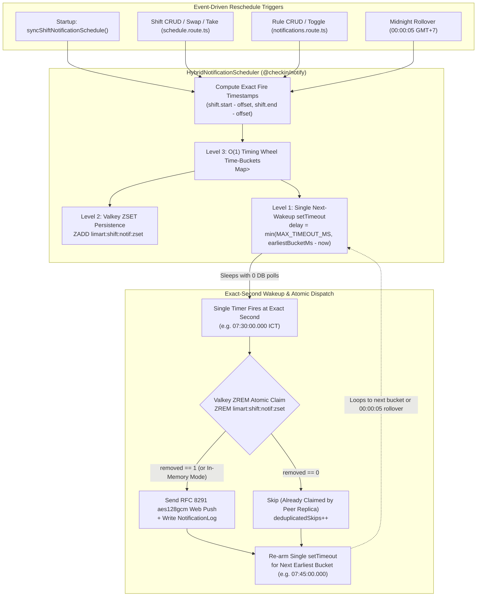

# `@checkin/notify` — Zero-Dependency Web Push, Telegram & Hybrid Timing-Wheel Scheduler

`@checkin/notify` provides zero-bloat, native `node:crypto` + `fetch` multi-channel notifications (**RFC 8292 VAPID ES256**, **RFC 8291 `aes128gcm` Web Push**, **Telegram Bot API**) and the **Hybrid Notification Scheduler** (`HybridNotificationScheduler`) powering LimArt's exact-second Shift Reminder Engine.

---

## Evolutionary Architecture of the Shift Reminder Scheduler

Replacing a naive 60-second `setInterval` database polling loop (`1,440` unnecessary DB queries/day with up to `±60s` notification jitter), `@checkin/notify` implements a **3-Layer Hybrid Architecture**:

| Layer | Component | Complexity & Overhead | Purpose |
| :--- | :--- | :--- | :--- |
| **Level 1** | **Single Next-Wakeup `setTimeout` Worker** | **Strictly `0` or `1` active timer** in V8/Bun (`0%` idle CPU, `0` DB queries while sleeping) | Calculates exact `delayMs = nextBucketMs - Date.now()` (clamped to 32-bit `MAX_TIMEOUT_MS = 2,147,483,647ms` / `~24.85 days`) and sleeps until the exact millisecond the earliest bucket matures. |
| **Level 2** | **Valkey `ZSET` Atomic Claim Adapter** | $O(\log N)$ `ZADD` / `ZRANGEBYSCORE` + $O(\log N)$ atomic `ZREM` | Persists scheduled job IDs in `limart:shift:notif:zset` (`score = bucketMs`). When multiple API replicas wake up simultaneously (e.g. during Blue-Green container swap), atomic `ZREM` guarantees **exactly one worker** dispatches each notification. |
| **Level 3** | **$O(1)$ Hierarchical Timing Wheel Time-Buckets** | $O(1)$ insert, $O(1)$ cancel, $O(1)$ bucket lookup via `Map<bucketMs, Map<jobId, Job>>` | Quantizes timestamps into 1-second slots (`bucketResolutionMs = 1000`). If 500 staff shifts start at `08:00:00`, all 500 `-30m` reminders group into a single bucket (`07:30:00.000`) with **1 timer**. |

---

## Architecture & Execution Flow (`mermaid`)



---

## Quick Usage

```ts
import { createNotificationScheduler } from '@checkin/notify';

const scheduler = createNotificationScheduler({
  bucketResolutionMs: 1000,
  zsetKey: 'limart:shift:notif:zset',
  zsetAdapter: () => redisClient,
  onDispatch: async (job) => {
    await sendNotificationToUser(job.payload.userId, job.payload);
  },
});

// O(1) bucket insertion + arms ONLY ONE setTimeout for the earliest bucket
scheduler.schedule({
  id: '2026-10-16:101:SHIFT_START_30M',
  fireAtMs: new Date('2026-10-16T07:30:00+07:00').getTime(),
  payload: {
    userId: 'user-1',
    title: '⏰ Sắp vào ca làm việc (còn 30 phút)',
    body: 'Chào Nguyễn Văn A, ca trực 08:00 - 12:00 sắp bắt đầu!',
  },
});

// Live telemetry for Admin Overview
console.log(scheduler.getTelemetry());
```
